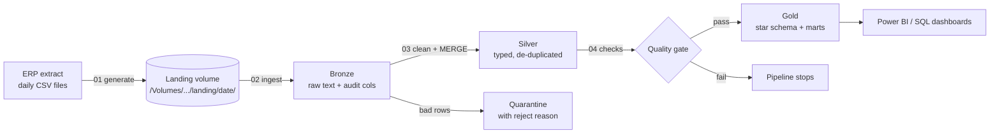

# ERP Order-to-Cash Data Pipeline (Databricks Lakehouse)

An end-to-end data engineering pipeline on **Databricks** that takes messy daily extracts from a (simulated) ERP order-to-cash process and turns them into a clean **star schema** and finance-ready **reporting marts** (revenue, AR aging, DSO).

**Stack:** Databricks (Free Edition, serverless) · PySpark · Spark SQL · Delta Lake · Unity Catalog volumes · Databricks Workflows · Python (Faker, pandas)

---

## Architecture



| Layer | Tables | What happens |
|---|---|---|
| **Landing** | `erp_raw.landing` (volume) | One folder of CSVs per day: customers, products, sales orders, order items, deliveries, invoices, payments |
| **Bronze** | `erp_bronze.<entity>` | Loaded as-is (all text) + `_source_file`, `_ingested_at`, `_batch_date`. Idempotent per batch (`replaceWhere`) |
| **Silver** | `erp_silver.<entity>`, `quarantine`, `dq_results` | Trim/case fixes, blank → NULL, two date formats parsed, safe casts, de-duplication, business rules + referential integrity, **Delta MERGE** upserts. Rejected rows kept in `quarantine` with the reason |
| **Gold** | `dim_date`, `dim_product`, `dim_customer` (**SCD2**), `fact_sales`, `fact_invoices`, `mart_revenue_monthly`, `mart_ar_aging`, `mart_dso_monthly` | Star schema; facts join to the customer version valid on the transaction date |

### Data engineering features
- **Medallion architecture** (bronze / silver / gold) on Delta Lake
- **Incremental loads** – each run processes only its own batch; silver uses `MERGE INTO` on business keys
- **SCD Type 2** customer dimension (history of address and credit-limit changes) with a single MERGE
- **Data quality gate** – 12 checks (uniqueness, referential integrity, valid values, freshness, quarantine rate); `error` checks fail the job before gold is built
- **Quarantine pattern** – bad records are kept with a reason instead of silently dropped
- **Idempotent reruns** – re-running a day replaces that day's data, never duplicates it
- **Orchestration** – Databricks Workflows job with task dependencies and a daily schedule

---

## Repo layout

```
notebooks/
  00_setup.py            create schemas + landing volume (run once)
  _common.py             config + shared helpers (MERGE upsert, SCD2, idempotent writes, safe parsing)
  01_generate_data.py    simulated ERP extract (messy on purpose)
  02_bronze_ingest.py    landing CSV -> bronze Delta tables
  03_silver_transform.py clean, de-duplicate, validate, quarantine, MERGE into silver
  04_data_quality.py     quality gate, results logged to dq_results
  05_gold_build.py       dims (SCD2), facts, marts
```

---

## How to run it (step by step)

### 1. Get a free Databricks workspace
Sign up for **Databricks Free Edition** (not the "free trial"). No credit card needed.

### 2. Put this code on GitHub
Create a new **public** repo called `erp-order-to-cash-pipeline` and upload these files (keep the `notebooks/` folder).

### 3. Bring the code into Databricks
In Databricks: **Workspace → Create → Git folder** → paste your repo URL → Create.
The `.py` files open as notebooks because each starts with `# Databricks notebook source`.

### 4. Run setup once
Open `00_setup`, attach **Serverless** compute, click **Run all**.
(The catalog is assumed to be `workspace`, the Free Edition default. If yours is named differently, change the `catalog` box at the top of every notebook.)

### 5. First run (initial load)
Run these notebooks in order with **Run all**, leaving `batch_date` blank (= today):
`01_generate_data` → `02_bronze_ingest` → `03_silver_transform` → `04_data_quality` → `05_gold_build`

The first run creates 500 customers, 40 products and ~90 days of order history.

### 6. Make it run by itself (Workflows)
**Jobs & Pipelines → Create → Job**, then add 5 tasks (type *Notebook*, compute *Serverless*):

| Task | Notebook | Depends on |
|---|---|---|
| `generate` | 01_generate_data | – |
| `bronze` | 02_bronze_ingest | generate |
| `silver` | 03_silver_transform | bronze |
| `quality` | 04_data_quality | silver |
| `gold` | 05_gold_build | quality |

Add **job parameters** `catalog = workspace` and `batch_date =` (empty). Add a **Schedule** trigger: daily.
Every day after that, the job adds a new day of orders, payments, new customers and customer changes.

### 7. Look at the results
In a SQL editor or notebook:

```sql
-- SCD2 history: customers who moved or got a new credit limit
SELECT customer_id, city, state, credit_limit, effective_from, effective_to, is_current
FROM workspace.erp_gold.dim_customer
WHERE customer_id IN (SELECT customer_id FROM workspace.erp_gold.dim_customer WHERE NOT is_current)
ORDER BY customer_id, effective_from;

-- What got rejected and why
SELECT entity, reason, COUNT(*) FROM workspace.erp_silver.quarantine GROUP BY ALL ORDER BY 1;

-- Quality gate history
SELECT * FROM workspace.erp_silver.dq_results ORDER BY checked_at DESC;

-- Finance answers
SELECT * FROM workspace.erp_gold.mart_dso_monthly;
SELECT aging_bucket, COUNT(*), SUM(open_amount) FROM workspace.erp_gold.mart_ar_aging GROUP BY ALL;
```

Optional: connect Power BI to the gold tables and build a revenue / AR dashboard.

---

## Design notes (good for interviews)

- **Why keep bronze as text?** Nothing is lost if parsing rules change; silver can always be rebuilt from bronze.
- **Why MERGE in silver?** Source systems resend changed records; MERGE updates existing keys and inserts new ones in one atomic Delta transaction.
- **How SCD2 works here:** incoming customer rows are hashed on tracked columns. If the hash differs from the current row, the MERGE closes the old row (`effective_to`, `is_current = false`) and inserts a new current row. Facts join on `order_date >= effective_from AND order_date < effective_to` (or the row is current), so July sales stay with the July address.
- **Why quarantine instead of drop?** Bad rows are auditable and can be fixed and replayed; the quality gate watches the reject rate.
- **Why are facts fully rebuilt?** At this data size a full refresh is simpler and always consistent. At larger scale they would switch to incremental MERGE by `order_date` partition.
- **DSO formula:** (accounts receivable at period end ÷ revenue invoiced in the period) × days in the period.
